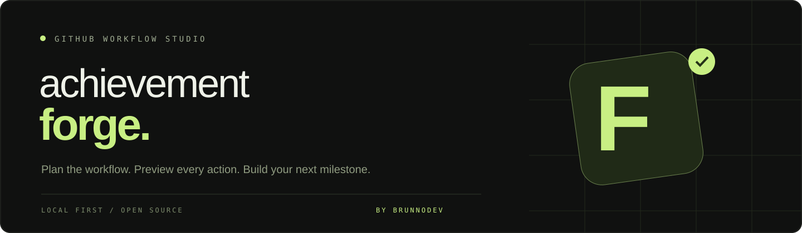

<p align="center"></p>

<p align="center"><strong>Plan the workflow. Preview every action. Build your next milestone.</strong></p>
<p align="center">Python standard library · Vanilla JavaScript · Local execution · Portuguese / English</p>

Achievement Forge is an original, dark GitHub workflow studio by [brunnodev](https://brunnodev.store). It orchestrates issue, pull request, merge and co-authorship exercises through the GitHub REST API, with an explicit execution preview and an inspectable activity log.

The interface uses a graphite and lime palette, compact workflow cards, a plan inspector and a terminal-style activity stream. It works on desktop and mobile and switches between Portuguese and English.

## What you can run

| Workflow | Automated operations | Iterations per plan |
| --- | --- | --- |
| Quickdraw | Create an issue and immediately close it | 1 |
| YOLO | Create a branch, commit a journal, open a PR and merge without requesting review | 1 |
| Pull Shark | Sequential branch → journal commit → PR → merge cycles | 1–8 |
| Pair Extraordinaire | Create a co-authored journal commit, open a PR and merge while preserving the commit | 1–8 |

These are workflow exercises associated with achievement mechanics, not a badge-granting API. **A successful run means the operations succeeded; it does not prove an achievement was awarded.** GitHub controls eligibility, thresholds, profile visibility and processing. Its achievement feature is in public preview and can change. This project does not read a private achievement API or report invented badge counts.

## Start in 30 seconds

Requires Python 3.10 or newer. No pip packages, Node installation or build step is required to run the app.

```bash
git clone https://github.com/brunnojob/achievement-forge.git
cd achievement-forge
python forge.py
```

Open **http://127.0.0.1:8787**. With no token, the application starts in clearly labeled **DEMO** mode. Preview a plan, type the repository name, and simulate the activity stream without contacting GitHub.

You can also serve `web/` with any static HTTP server for an interface-only demo. The app automatically detects that the local API is absent. Static hosting cannot perform live operations.

## Enable live execution

1. Create a separate repository under your own GitHub account, initialized with a README and with issues enabled. Keep exercises separate from application source repositories.
2. Create a fine-grained GitHub personal access token restricted to that repository. Allow **Contents: read/write**, **Issues: read/write**, **Pull requests: read/write**, and the automatically granted metadata access. The app reads `/user` to verify ownership. Do not grant administration or workflow permissions.
3. Set `GITHUB_TOKEN` in the process environment and run `python forge.py`. The header must show **LIVE**.

Linux / macOS, without putting the token in shell history:

```bash
read -rs -p "GitHub token: " GITHUB_TOKEN
export GITHUB_TOKEN
python forge.py
unset GITHUB_TOKEN
```

Windows PowerShell:

```powershell
$secret = Read-Host "GitHub token" -AsSecureString
$env:GITHUB_TOKEN = [System.Net.NetworkCredential]::new('', $secret).Password
python forge.py
Remove-Item Env:GITHUB_TOKEN
```

The `.env.example` file documents configuration; dotenv files are not automatically loaded. Set `FORGE_PORT` to use a different local port.

## Run a workflow

Choose a workflow → enter `owner/repository` → choose the iteration count → preview the plan → type the exact repository name → execute.

For Pair Extraordinaire, enter the actual collaborator's name and their GitHub-associated email and confirm that they participated and agreed to attribution. The engine adds a `Co-authored-by` trailer and uses merge commits so the original co-authored commit remains intact. The journal exercise alone cannot establish that two people actually collaborated.

The plan is valid for 15 minutes and can only be executed once. Changing the configuration invalidates the visible preview. Only one execution runs at a time. Quickdraw and YOLO are single-iteration flows; the other flows are capped at eight operations per plan.

## Execution and recovery

- Tokens stay in the Python process; the interface never asks for or stores them.
- Live execution is limited to repositories owned by the authenticated account. Organization and third-party repositories are rejected.
- The local server binds to `127.0.0.1`, verifies the Host and Origin, and requires a per-process CSRF token on mutations.
- Pull requests are merged against the exact SHA created by the exercise. A changed PR head stops the merge. Existing branch protection and repository rules remain authoritative.
- Mutating GitHub calls are not automatically retried. If a network error occurs after GitHub accepted a request, inspect the repository before creating another plan.
- Stop requests take effect between API operations. An in-flight GitHub call cannot be recalled. Already-created issues, branches, commits and PRs are retained, including on failure.
- Successful PR branches are also retained for inspection. Each exercise uses a unique branch and file under `.achievement-forge/`.
- The UI supports JSON export. Server events append to ignored `.local/audit.jsonl`; co-author email is not written to this event log, but is included in the Git commit as required for attribution.
- Plans and UI state live in memory. Restarting the server does not resume an unfinished plan. The audit file provides event references, not a durable job queue.

If a repository requires checks, approvals or a different merge policy, the operation can fail. The tool does not bypass those settings or claim that a rejected merge succeeded. Quickdraw timing and achievement eligibility are evaluated by GitHub.

## Development

```bash
python -m unittest discover -s tests -v
node --check web/app.js
```

Node is only needed for the optional JavaScript syntax check. CI runs Python tests on 3.10, 3.12 and 3.13. The tests use a fake GitHub transport and a real loopback HTTP server; they do not create public issues or PRs.

```text
forge.py                 Local HTTP API, GitHub client, workflow engine
web/index.html           Accessible, responsive workspace
web/style.css            Original graphite and lime visual system
web/app.js               PT/EN interface, preview, activity log, export
tests/test_forge.py      Workflow, merge integrity and HTTP boundary tests
.github/workflows/ci.yml Test matrix and JavaScript syntax validation
```

## Em português

Um estúdio local para automatizar os fluxos Quickdraw, YOLO, Pull Shark e Pair Extraordinaire, com visual próprio, prévia de execução, registro de atividade e exportação JSON. Execute `python forge.py` para experimentar sem token. Para operações reais, configure `GITHUB_TOKEN` no ambiente e selecione um repositório seu reservado para exercícios. O GitHub decide quando e se uma badge será concedida.

## References and authorship

- [GitHub profile reference and achievements](https://docs.github.com/en/account-and-profile/reference/profile-reference)
- [GitHub REST API: pull requests and merges](https://docs.github.com/en/rest/pulls/pulls)
- [Creating commits with multiple authors](https://docs.github.com/en/pull-requests/how-tos/commit-changes/creating-a-commit-with-multiple-authors)
- [Managing fine-grained personal access tokens](https://docs.github.com/en/authentication/keeping-your-account-and-data-secure/managing-your-personal-access-tokens)

The product category was inspired by a user-supplied video reference. This repository contains a new implementation and original interface; it does not include the video's source code, branding, badge artwork or assets. Not affiliated with or endorsed by GitHub.

Created by **[brunnodev](https://brunnodev.store)** · [@brunnojob](https://github.com/brunnojob). Released under the [MIT License](LICENSE).
